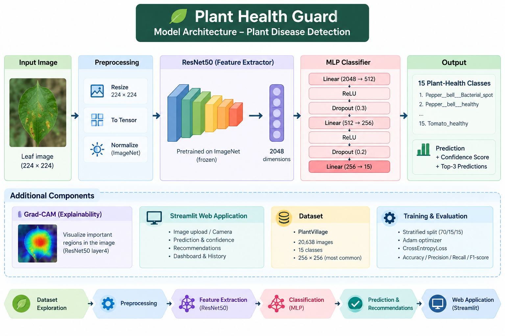
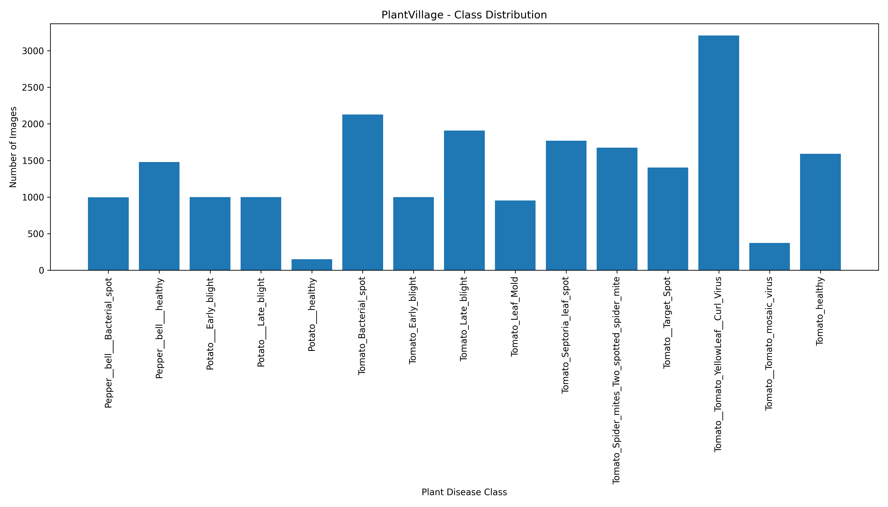
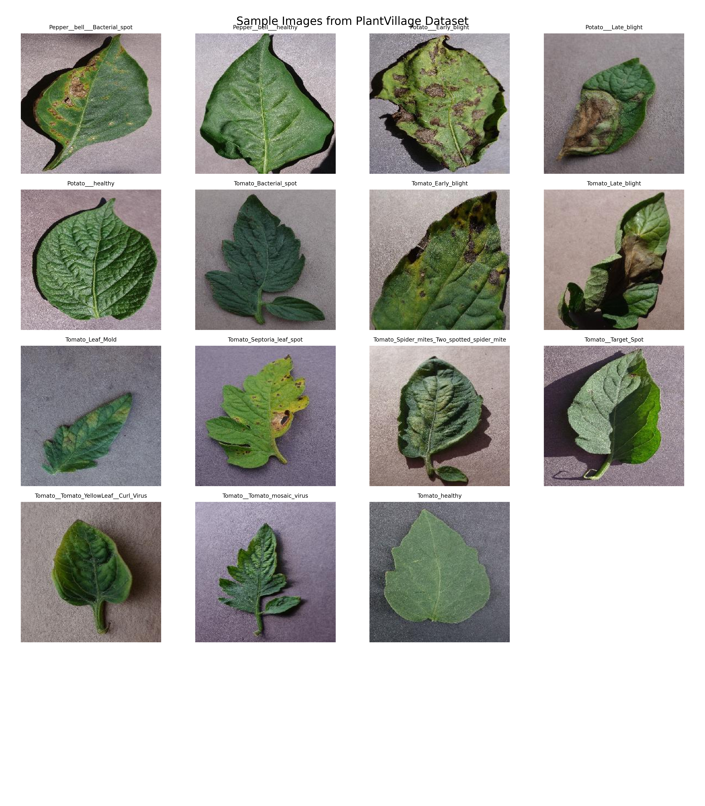
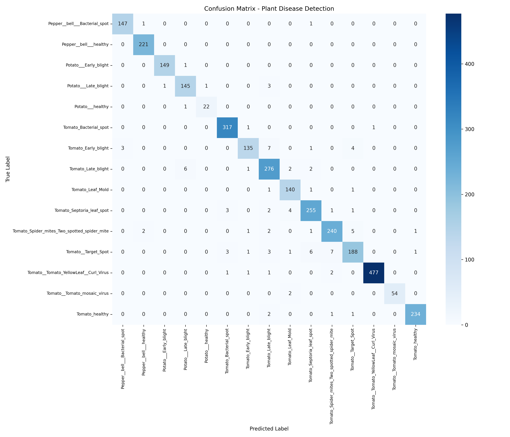
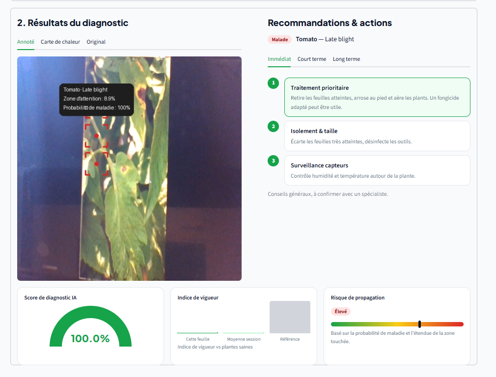

# Plant Health Guard

**Plant Disease Detection using Deep Learning and Transfer Learning**

Plant Health Guard is a machine learning project designed to detect plant diseases from leaf images. The project uses **ResNet50** as a pretrained feature extractor and a custom **Multi-Layer Perceptron (MLP)** classifier to identify diseases across 15 plant-health classes.

The project also includes a **Streamlit web application** that allows users to upload an image or use a camera image, obtain a disease prediction, view the confidence score, receive treatment/prevention recommendations, and visualize model explanations using **Grad-CAM**.

## Project Overview

Plant diseases can significantly affect crop production and plant health. Early detection can help farmers and users identify potential diseases and take appropriate action.

This project applies **Deep Learning** and **Transfer Learning** to classify plant leaf images into different disease categories.

The main pipeline is:

```text
PlantVillage Dataset
        ↓
Dataset Exploration
        ↓
Preprocessing
        ↓
ResNet50 Feature Extraction
        ↓
2048-dimensional Features
        ↓
MLP Classifier
        ↓
Disease Prediction
        ↓
Streamlit Application
```

### Architecture Diagram



---

## Objectives

The main objectives of this project are:

* Explore and understand the PlantVillage dataset.
* Preprocess and split the dataset into training, validation, and testing sets.
* Use a pretrained **ResNet50** model for feature extraction.
* Train an **MLP classifier** using the extracted features.
* Evaluate the model using several classification metrics.
* Build an interactive web application using **Streamlit**.
* Provide prediction confidence and recommendations.
* Add model explainability using **Grad-CAM**.

---

## Features

### Machine Learning

* Transfer Learning with ResNet50.
* Feature extraction using a pretrained CNN.
* 2048-dimensional image features.
* Custom MLP classifier.
* 15 plant-health classes.
* Stratified train/validation/test split.
* Evaluation using Accuracy, Precision, Recall, and F1-score.

### Web Application

The Streamlit application provides:

* Home page.
* Image upload.
* Camera image analysis.
* Disease prediction.
* Confidence score.
* Top-3 predictions.
* Disease risk level.
* Treatment and prevention recommendations.
* Grad-CAM visualization.
* Dashboard.
* Prediction history.
* Basic insights.

---

# Dataset

The project uses the **PlantVillage dataset** for plant disease classification.

The selected dataset contains:

* **20,638 images**
* **15 classes**
* Most common image resolution: **256 × 256 pixels**
* Corrupted images detected: **0**

The dataset contains images from pepper, potato, and tomato plants.

### Classes

| Class                                       | Images |
| ------------------------------------------- | -----: |
| Pepper__bell___Bacterial_spot               |    997 |
| Pepper__bell___healthy                      |  1,478 |
| Potato___Early_blight                       |  1,000 |
| Potato___Late_blight                        |  1,000 |
| Potato___healthy                            |    152 |
| Tomato_Bacterial_spot                       |  2,127 |
| Tomato_Early_blight                         |  1,000 |
| Tomato_Late_blight                          |  1,909 |
| Tomato_Leaf_Mold                            |    952 |
| Tomato_Septoria_leaf_spot                   |  1,771 |
| Tomato_Spider_mites_Two_spotted_spider_mite |  1,676 |
| Tomato__Target_Spot                         |  1,404 |
| Tomato__Tomato_YellowLeaf__Curl_Virus       |  3,208 |
| Tomato__Tomato_mosaic_virus                 |    373 |
| Tomato_healthy                              |  1,591 |

### Class Distribution



### Sample Images



---

# Dataset Exploration

Before training, the dataset was analyzed to understand:

* Number of classes.
* Number of images per class.
* Image dimensions.
* Dataset balance.
* Image integrity.

The exploration showed that the dataset contains **20,638 images across 15 classes**, with no corrupted images detected.

The class distribution is not perfectly balanced. For example, `Tomato__Tomato_YellowLeaf__Curl_Virus` contains 3,208 images, while `Potato___healthy` contains only 152 images.

This class imbalance should be considered when interpreting per-class performance.

---

# Preprocessing

The dataset was divided using a **stratified split**:

| Dataset    |     Images | Percentage |
| ---------- | ---------: | ---------: |
| Training   |     14,446 |        70% |
| Validation |      3,096 |        15% |
| Test       |      3,096 |        15% |
| **Total**  | **20,638** |   **100%** |

Stratification was used to preserve the class distribution across the different subsets.

For ResNet50, images were transformed to:

* Resize: **224 × 224**
* Convert to tensor.
* ImageNet normalization.

---

# Model Architecture

The project uses a pretrained **ResNet50** network as a feature extractor.

The original classification layer was removed and replaced by an identity layer:

```python
model.fc = nn.Identity()
```

Therefore, ResNet50 produces a **2048-dimensional feature vector** for each image.

### ResNet50 Configuration

| Parameter            | Value      |
| -------------------- | ---------- |
| Architecture         | ResNet50   |
| Pretrained           | Yes        |
| Feature dimension    | 2048       |
| Input size           | 224 × 224  |
| Trainable parameters | 30,735     |
| Total parameters     | 23,538,767 |
| Device               | CPU        |

The ResNet50 backbone is frozen during the MLP training stage.

---

# Feature Extraction

Feature extraction is performed independently for the training, validation, and test datasets.

The resulting feature files are stored in:

```text
features/
├── train_features.pt
├── val_features.pt
└── test_features.pt
```

Training features:

```text
torch.Size([14446, 2048])
```

Validation features:

```text
torch.Size([3096, 2048])
```

Each image is therefore represented by a vector of **2048 numerical features**.

---

# MLP Classifier

After extracting features with ResNet50, a custom Multi-Layer Perceptron is used for classification.

The architecture is:

```text
Input: 2048
   ↓
Linear(2048 → 512)
   ↓
ReLU
   ↓
Dropout(0.3)
   ↓
Linear(512 → 256)
   ↓
ReLU
   ↓
Dropout(0.2)
   ↓
Linear(256 → 15)
   ↓
Output
```

The final layer contains **15 neurons**, corresponding to the 15 plant-health classes.

---

# Training

The MLP classifier was trained with the following configuration:

| Parameter     | Value            |
| ------------- | ---------------- |
| Batch size    | 64               |
| Epochs        | 20               |
| Optimizer     | Adam             |
| Learning rate | 0.001            |
| Loss function | CrossEntropyLoss |
| Device        | CPU              |

The best validation accuracy was obtained at **epoch 12**:

**Validation Accuracy: 96.93%**

### Selected Training Results

| Epoch | Train Accuracy | Validation Accuracy |
| ----: | -------------: | ------------------: |
|     1 |         75.47% |              91.83% |
|     6 |         97.81% |              95.83% |
|    10 |         98.83% |              96.90% |
|    12 |         98.95% |          **96.93%** |
|    20 |         98.98% |              96.77% |

The training accuracy continues to increase while validation accuracy fluctuates slightly. This indicates that the model begins to show a small amount of overfitting during later epochs.

### Training Curves


---

# Evaluation Results

The final model was evaluated on the independent test set.

### Test Performance

| Metric    |      Score |
| --------- | ---------: |
| Accuracy  | **96.90%** |
| Precision | **96.91%** |
| Recall    | **96.90%** |
| F1-score  | **96.89%** |

These results indicate that the model performs strongly on the PlantVillage test set.

The validation accuracy was **96.93%**, while the test accuracy was **96.90%**, resulting in a very small difference of approximately **0.03 percentage points**.

### Confusion Matrix



The confusion matrix provides a more detailed view of the predictions for each class and helps identify classes that are more frequently confused by the model.

---

# Explainability

To improve interpretability, the project uses **Grad-CAM (Gradient-weighted Class Activation Mapping)**.

Grad-CAM helps visualize the image regions that contribute most to the model's prediction.

The implementation uses the last convolutional block of ResNet50:

```text
ResNet50 → layer4 → Grad-CAM
```

This allows the application to highlight regions of the leaf that influenced the prediction.

### Grad-CAM Example



Grad-CAM does not prove that the model is medically or agriculturally correct. Instead, it provides a visual explanation of which image regions were important for the model's decision.

---

# Streamlit Application

The project includes an interactive web application built with **Streamlit**.

The application contains the following pages:

```text
Accueil
Importer une image
Scan caméra
Tableau de bord
Historique & insights
```

## Main functionalities

### Image Upload

Users can upload a plant leaf image and obtain a prediction.

The application returns:

* Predicted disease.
* Confidence score.
* Top-3 predictions.
* Risk level.
* Recommendations.

### Camera Scan

The application can also analyze an image captured using the camera interface.

### Recommendations

Based on the predicted disease, the application provides basic recommendations related to:

* Treatment.
* Prevention.
* Monitoring.

### Dashboard

The dashboard summarizes the predictions performed during the current application session.

### History

The application keeps prediction history in the Streamlit session state.

No external database is required.

---

# Project Structure

```text
plant-disease-detection/
│
├── dataset/
│   ├── raw/
│   ├── train/
│   ├── validation/
│   ├── test/
│   └── PlantVillage/
│
├── src/
│   ├── exploration.py
│   ├── preprocessing.py
│   ├── model.py
│   ├── extract_features.py
│   ├── train.py
│   ├── evaluate.py
│   └── predict.py
│
├── app/
│   └──app.py
│
│
├── models/
│   └── plant_disease_classifier.pth
│
├── features/
│   ├── train_features.pt
│   ├── val_features.pt
│   └── test_features.pt
│
├── results/
│   ├── figures/
│   └── metrics/
│
├── requirements.txt
├── Dockerfile
├── .dockerignore
├── .gitignore
└── README.md
```

---

# Installation

## 1. Clone the repository

```bash
git clone https://github.com/1Oumaima1/plant-disease-detection
cd plant-disease-detection
```


## 2. Create a virtual environment

On Windows:

```cmd
python -m venv .venv
```

Activate it:

```cmd
.venv\Scripts\activate
```

## 3. Install dependencies

```cmd
pip install -r requirements.txt
```

The main dependencies are:

* Python
* PyTorch
* Torchvision
* Streamlit
* NumPy
* Pandas
* Pillow

---

# Running the Application

From the project root:

```cmd
streamlit run app\app.py
```

The application will normally be available at:

```text
http://localhost:8501
```

---

# Docker

The project also includes a Docker configuration.

## Build the Docker image

```cmd
docker build -t plant-health-guard .
```

## Run the container

```cmd
docker run -p 8501:8501 plant-health-guard
```

Then open:

```text
http://localhost:8501
```

Docker provides a reproducible environment for running the application.

---

# Example Prediction

The prediction script can also be used directly from the command line.

Example:

```cmd
python src\predict.py "dataset\test\Pepper__bell___Bacterial_spot\0a4c007d-41ab-4659-99cb-8a4ae4d07a55___NREC_B.Spot 1954.JPG"
```

Example output:

```text
Disease   : Pepper__bell___Bacterial_spot
Confidence: 100.00%

Top 3:
1. Pepper__bell___Bacterial_spot (100.00%)
2. Pepper__bell___healthy (0.00%)
3. Potato___Late_blight (0.00%)
```

The confidence score represents the model's confidence among the **15 classes used during training**. It should not be interpreted as absolute certainty in real-world conditions.

---

# Limitations

Although the model achieves high performance on the PlantVillage test set, several limitations should be considered.

### Dataset limitation

PlantVillage images are relatively controlled compared with real-world agricultural environments.

Real images may contain:

* Different lighting conditions.
* Complex backgrounds.
* Multiple leaves.
* Different camera qualities.
* Multiple diseases on the same plant.
* Symptoms at different stages.

### Model limitation

A confidence score such as 100% does not guarantee that the prediction is correct.

The model can still make incorrect predictions when presented with images that are significantly different from the training data.

### Generalization

Additional testing on real-world field images would be necessary before considering the system for professional agricultural diagnosis.

---

# Future Improvements

Possible future improvements include:

* Fine-tuning deeper ResNet50 layers.
* Data augmentation.
* Class balancing techniques.
* Testing additional CNN architectures.
* Comparing ResNet50 with EfficientNet or MobileNet.
* Improving real-world image generalization.
* Adding a larger field-image dataset.
* Improving disease recommendations.
* Adding multilingual support.
* Adding more plant species.
* Improving uncertainty detection.
* Deploying the application to a cloud platform.
* Adding automated model monitoring.

---

# Technologies Used

| Technology  | Purpose                            |
| ----------- | ---------------------------------- |
| Python      | Main programming language          |
| PyTorch     | Deep Learning framework            |
| Torchvision | ResNet50 and image transformations |
| ResNet50    | Feature extraction                 |
| MLP         | Disease classification             |
| Streamlit   | Web application                    |
| NumPy       | Numerical processing               |
| Pandas      | Data analysis                      |
| Pillow      | Image processing                   |
| Docker      | Containerization                   |
| Grad-CAM    | Model explainability               |

---

# Reproducibility

The project separates the different stages of the machine learning pipeline:

```text
exploration.py
      ↓
preprocessing.py
      ↓
model.py
      ↓
extract_features.py
      ↓
train.py
      ↓
evaluate.py
      ↓
predict.py
```

This structure makes it easier to reproduce the experiments and understand each step of the project.

---

# Important Note

The dataset and extracted feature files are not included in the GitHub repository because of their size.

The `.gitignore` file excludes:

```text
dataset/
features/
results/
```

The trained model checkpoint is kept separately because it is required by the Streamlit application.

Before running the complete training pipeline, the required dataset should be downloaded and placed in the appropriate directory.

---

# GitHub Clone

To obtain the project:

```bash
git clone https://github.com/1Oumaima1/plant-disease-detection.git
cd plant-disease-detection
```

Then install the dependencies:

```cmd
pip install -r requirements.txt
```

And launch the application:

```cmd
streamlit run app\app.py
```

---

## 👩‍💻 Amlou Oumaima
